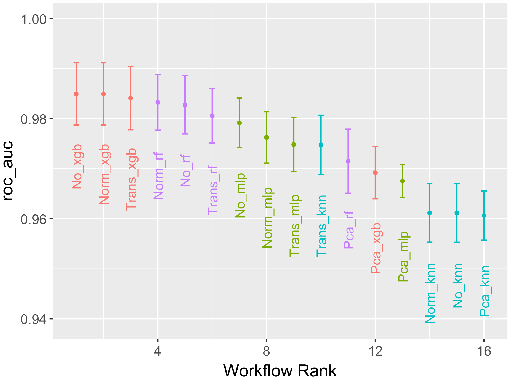
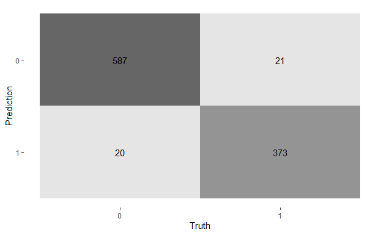
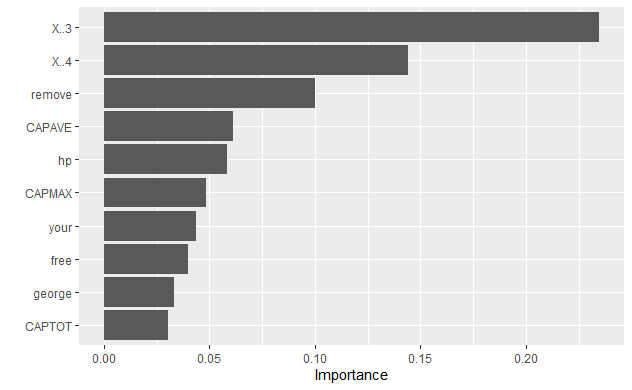

# Pipelines de machine learning reproductibles avec tidymodels

Projet réalisé dans le cadre du Master MSID (Université de Pau et des Pays de l'Adour).

Ce dépôt présente l'écosystème **tidymodels**, un ensemble de packages R qui permet de construire des workflows reproductibles, du prétraitement des données jusqu'à l'évaluation des modèles. Il est appliqué au jeu de données spam (environ 4 000 e-mails, 57 variables).

## Démarche

4 recettes de prétraitement sont croisées avec 4 modèles dans un seul `workflow_set`, soit 16 pipelines :

| Recettes | Modèles |
|---|---|
| données brutes | Random Forest |
| normalisation | KNN |
| ACP (10 composantes) | XGBoost |
| Yeo-Johnson, filtre des corrélations, termes quadratiques | perceptron multicouche |

Chaque pipeline est réglé sur 15 combinaisons d'hyperparamètres par validation croisée à 10 blocs, avec l'AUC comme critère. Le meilleur est ensuite évalué sur un échantillon test de 25 %.

## Résultats



*Classement des workflows selon l'AUC en validation croisée.*

XGBoost et Random Forest dominent. XGBoost sur données brutes et XGBoost sur données normalisées sont exactement à égalité (AUC de 0,985, même erreur standard, mêmes hyperparamètres retenus). Ce n'est pas un hasard : un arbre de décision coupe chaque nœud selon une règle « xⱼ < s », et le gain d'un découpage ne dépend que de la répartition des observations de part et d'autre du seuil, pas des valeurs de xⱼ. Une normalisation est croissante : elle conserve l'ordre des observations, donc les mêmes partitions sont possibles et les mêmes sont choisies. Seul le seuil change d'échelle. À score égal, le pipeline sans prétraitement est retenu.

À l'inverse, l'ACP fait baisser les performances de tous les modèles, et le perceptron multicouche, sensible à l'échelle des variables, change de score selon la recette. Les KNN sont à égalité avec et sans normalisation parce que le package `kknn` normalise déjà les variables par défaut.

*Matrice de confusion du modèle final sur l'échantillon test.*



*Courbe ROC sur l'échantillon test (AUC = 0,984).*



*Importance des variables du modèle XGBoost final.*

## Fichiers

- `projet_app.Rmd` : code complet
- `data/spam.txt` : données

## Packages

```r
install.packages(c("tidymodels", "randomForest", "xgboost", "kknn", "nnet", "doParallel", "vip"))
```
